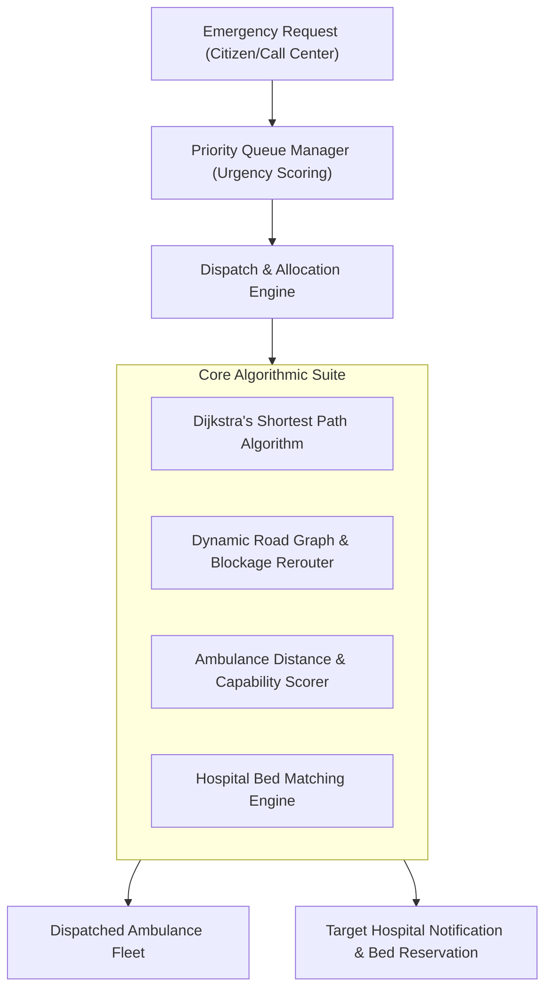

# 🚑 Smart Emergency Response & Dispatch Management System

[](https://www.oracle.com/java/)
[](https://spring.io/projects/spring-boot)
[](https://react.dev/)
[](https://vitejs.dev/)
[](https://opensource.org/licenses/MIT)

An enterprise-grade, full-stack emergency medical dispatch and hospital triage coordination system designed to minimize emergency response times through algorithmic path optimization, live road blockage avoidance, dynamic ambulance scoring, and automated hospital bed allocation.

---

## 📌 Problem & System Overview

During critical emergencies, delays in dispatching the nearest equipped ambulance, taking congested or blocked roads, or arriving at a hospital with zero available ICU beds cost human lives.

This platform bridges emergency call centers, paramedic fleets, and regional hospitals into a **synchronized real-time response network**:
* **Graph-Based Road Network**: Dynamically calculates the fastest routes using **Dijkstra’s Algorithm** while rerouting around real-time road blockages.
* **Triage Priority Queue**: Evaluates emergency severity levels using multi-criteria queue prioritization.
* **Smart Ambulance Allocation Engine**: Scores and assigns the optimal ambulance based on geographic proximity, vehicle capability (ALS/BLS), and readiness.
* **Hospital Bed Availability Coordination**: Matches patients with nearby hospitals possessing verified emergency and ICU bed vacancies.

---

## 🧠 Algorithmic Core & Architecture



### Core Algorithms Implemented
1. **`DijkstraAlgorithm.java` & `RoadGraph.java`**: Implements custom directed graph pathfinding over weighted road networks (`GraphNode`, `GraphEdge`), supporting dynamic edge weight penalties for traffic congestion and complete edge exclusion during road blockages.
2. **`EmergencyPriorityQueueManager.java`**: Manages incoming crisis calls using a custom comparator that balances medical triage severity against arrival wait times.
3. **`AmbulanceScorer.java`**: Evaluates available units across distance, vehicle equipment tier (Basic Life Support vs. Advanced Life Support), and driver status.
4. **`HospitalSelectionResult.java`**: Evaluates facility distance, emergency department workload, and live ICU/Emergency bed capacity.

---

## 🛠️ Technology Stack

| Layer | Technologies |
| :--- | :--- |
| **Backend Framework** | Java 17+, Spring Boot 3, Spring Data JPA, Spring Security |
| **Algorithms & Data Structures** | Custom Graph Traversal, Priority Queues, Dijkstra Shortest Path |
| **Database & ORM** | MySQL / PostgreSQL / H2 In-Memory Database, Hibernate ORM |
| **Frontend UI** | React 18, Vite, React Router, Context API, Tailwind CSS |
| **Interactive Mapping** | Leaflet / OpenStreetMap for live emergency location plotting & route visualization |
| **Architecture** | Clean Layered Architecture (Controllers, Services, DTOs, Repositories, Entities) |

---

## 🖥️ System Portals & Features

### 1. 🚨 Citizen & Emergency Caller Portal
* One-click location picker with reverse geocoding.
* Emergency severity classification (Cardiac, Trauma, Respiratory, General).
* Live status tracker showing assigned ambulance and ETA.

### 2. 🎛️ Central Dispatch & Admin Dashboard
* **Interactive Live Map**: Real-time visual monitoring of all ambulances, hospital locations, and reported incidents.
* **Priority Queue Monitor**: Real-time triage list ordered by algorithmic urgency.
* **Road Network Management**: Add road nodes, edges, toggle road blockage states, and visualize rerouting in real time.
* **Ambulance Management**: Track status (`AVAILABLE`, `DISPATCHED`, `BUSY`, `MAINTENANCE`).

### 3. 🏥 Hospital Operations Portal
* Real-time ICU and Emergency bed capacity counter (`AVAILABLE`, `OCCUPIED`, `RESERVED`).
* Pre-arrival incoming patient notifications with vital information.

---

## 📁 Project Structure

```text
SmartEmergencySystem/
├── backend/
│   ├── pom.xml
│   └── src/main/java/com/emergency/system/
│       ├── algorithm/         # Dijkstra, Priority Queue, Ambulance Scorer
│       ├── controller/        # REST Controllers (Emergency, Hospital, Road, Ambulance)
│       ├── dto/               # Request & Response Data Transfer Objects
│       ├── entity/            # JPA Entities (Ambulance, Hospital, RoadNode, Trip)
│       ├── repository/        # Spring Data Repositories
│       └── service/           # Business logic & algorithm integration
└── frontend/
    ├── package.json
    ├── vite.config.js
    └── src/
        ├── components/        # Reusable UI widgets & Leaflet Map components
        ├── pages/             # Admin, Emergency, Hospital & User views
        └── services/          # Axios REST API integration clients
```

---

## ⚡ Setup & Execution Guide

### Prerequisites
* **Java 17 or higher** & **Apache Maven**
* **Node.js 18+** & **npm**
* **MySQL Server**

### 1. Backend Setup
```bash
cd backend
mvn clean install
mvn spring-boot:run
```
*Backend runs on: `http://localhost:8080`*

### 2. Frontend Setup
```bash
cd frontend
npm install
npm run dev
```
*Frontend runs on: `http://localhost:5173`*

---

